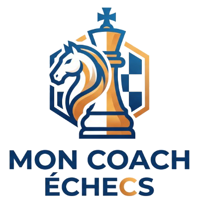
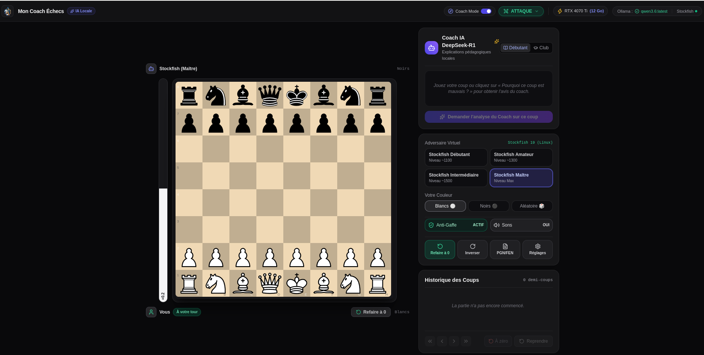
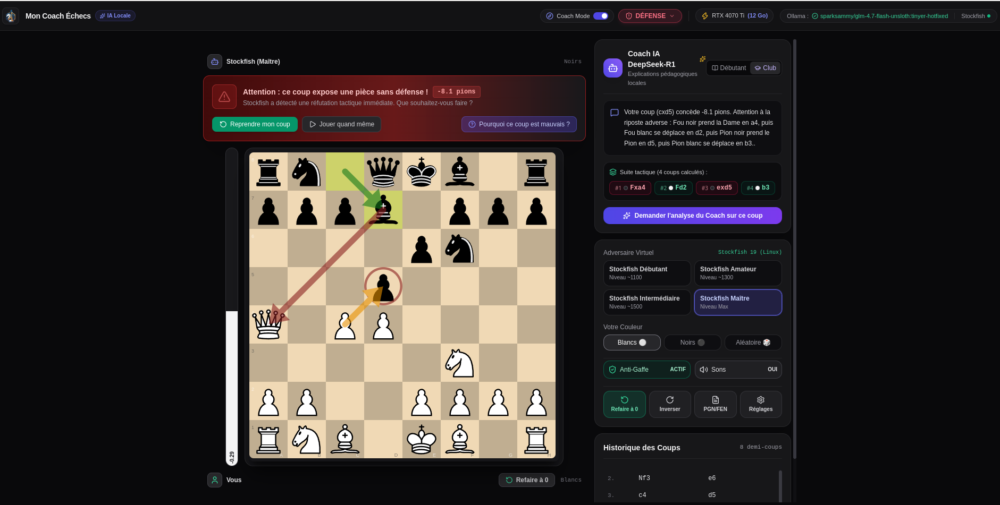
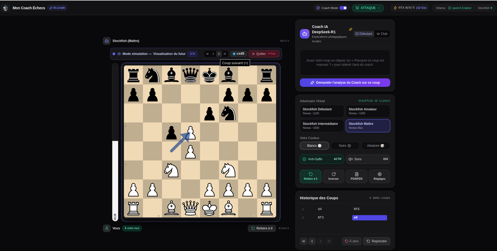

# ♚ Mon Coach Échecs

<div align="center">



### **L'Application Desktop d'Entraînement aux Échecs Assistée par IA Locale & Gratuite à Vie**
*Ergonomie 100 % intuitive • Zéro abonnement payant • 100 % Hors-ligne & Respect total de votre vie privée*

---

[](LICENSE)
[](src/tests)
[](coverage)
[](https://electronjs.org)
[](https://react.dev)
[](https://www.typescriptlang.org)
[](https://stockfishchess.org)
[](https://ollama.com)

[⬇️ Télécharger pour Windows (Releases)](#-téléchargement--releases) • [✨ Fonctionnalités Clés](#-fonctionnalités-phares) • [🚀 Démarrage Rapide](#-guide-de-démarrage-rapide) • [🛠 Compiler le Projet](#-guide-de-compilation-multi-plateforme)

</div>

---

## 📸 Aperçu de l'Interface

<div align="center">
  
  <p><em>Vue principale : Échiquier Chessground 60 FPS, Jauge d'évaluation Stockfish 19 en temps réel, Panneau IA & Badges matériel GPU/VRAM.</em></p>
</div>

---

## 💡 Pourquoi Mon Coach Échecs ?

Les grandes plateformes en ligne enferment leurs explications pédagogiques derrière des abonnements coûteux (jusqu'à **15 € / mois** pour un coaching textuel limité). À l'opposé, les logiciels libres traditionnels sont souvent austères, complexes à configurer et incapables d'expliquer une erreur en français accessible.

**Mon Coach Échecs réinvente l'apprentissage :**
* 🧠 **Un Vrai Coach Conversationnel (DeepSeek-R1 / Ollama)** : Fini les flèches cryptiques. L'IA analyse la position avec Stockfish et vous explique la logique tactique en 2 à 3 phrases claires et bienveillantes, sans hallucinations.
* 🛡️ **Un Bouclier Anti-Gaffe Proactif** : L'ordinateur intercepte vos erreurs critiques avant que vous ne perdiez une pièce et vous invite à réfléchir.
* ♟️ **Un Adversaire à Comportement Humain (Maia Chess)** : Jouez contre des réseaux de neurones entraînés sur de vraies parties humaines de niveau Débutant (~1100), Amateur (~1300) ou Club (~1500), au lieu d'un robot qui calcule froidement.
* 👻 **Ghost Board (Simulation Interactive)** : Visualisez et rejouez les variantes futures directement sur le plateau sans toucher à votre vraie partie.
* 🔒 **100 % Local, Privé & Gratuit** : Tout tourne directement sur votre machine (CPU & GPU). Aucune connexion requise, zéro compte, zéro pistage.

---

## ✨ Fonctionnalités Phares

### 1. 🛡️ Le Bouclier Anti-Gaffe en Temps Réel

Ne perdez plus bêtement vos pièces par inattention ! Dès que vous effectuez un coup, Stockfish vérifie instantanément si celui-ci provoque une chute d'évaluation supérieure à 2 pions.

<div align="center">
  
</div>

* **Interception immédiate** : Le coup n'est pas envoyé au bot tant que vous n'avez pas validé.
* **Choix pédagogique en 1 clic** :
  * ↩️ **Reprendre mon coup** : Annule le coup pour chercher une meilleure alternative.
  * ⚡ **Jouer quand même** : Valide l'erreur pour voir comment le bot vous punit.
  * 💬 **Pourquoi ce coup est mauvais ?** : Interroge le Coach IA pour comprendre la réfutation.

---

### 2. 🧭 Le Coach Décisionnel Progressif (4 Paliers)

Au lieu de vous donner directement la solution, le coach vous accompagne avec des indices graduels pour développer votre propre vision tactique.

| Palier | Nom | Ce qu'il vous apprend |
| :---: | :--- | :--- |
| **0** | **État Général** | Indique si vous êtes en position d'**Attaque** (opportunité) ou de **Défense** (menace urgente). |
| **1** | **Nature du Problème** | Précise la nature de la situation : Mat imminent, Gain/Perte matériel, ou Avantage positionnel. |
| **2** | **Pièce Cible** | Désigne la pièce clé sur laquelle porte l'action (ex. *« Cavalier adverse en c6 »*, *« Votre Fou en b7 »*). |
| **3** | **Simulation Complète** | Débloque le mode **Ghost Board** pour visualiser la séquence complète coup par coup. |

<div align="center">
  <table width="100%">
    <tr>
      <td width="50%" align="center">
        
        <br /><em>Mode Attaque : Détection d'opportunités de gain.</em>
      </td>
      <td width="50%" align="center">
        
        <br /><em>Mode Défense : Alerte sur une menace adverse critique.</em>
      </td>
    </tr>
  </table>
</div>

---

### 3. 👻 Le Ghost Board (Simulation Interactive Pas-à-Pas)

Accessible depuis le Palier 3 du coach décisionnel, le **Ghost Board** transforme l'échiquier en laboratoire d'analyse temporaire :

<div align="center">
  
</div>

* **Navigation Pas-à-Pas** : Parcourez la variante tactique recommandée grâce aux boutons Précédent / Suivant.
* **Flèches Tactiques Colorées** : Flèches vertes pour vos coups optimaux, flèches rouges pour les ripostes de l'adversaire.
* **Sécurité Absolue** : Quittez la simulation à tout moment avec la touche Échap ou le bouton *« Quitter »* : votre partie réelle reprend instantanément là où vous en étiez.

---

### 4. 🎓 Explications en Langage Naturel (Coach IA Local)

Connecté au serveur local [Ollama](https://ollama.com) (DeepSeek-R1, Qwen2.5, Mistral, etc.), le coach décortique la situation :

<div align="center">
  
</div>

* **Zéro Hallucination** : Le calcul tactique provient de Stockfish 19 ; le modèle de langage se concentre exclusivement sur l'explication pédagogique en français.
* **2 Niveaux de Vocabulaire** :
  * **Débutant** : Langage simple, imagé, sans jargon intimidant (*« Ta pièce n'est pas protégée »*).
  * **Club** : Termes échiquéens précis (*enfilade, clouage, déviation, tempo, avant-poste*).
* **Étapes Décomposées** : Boutons interactifs sous le message permettant de surligner chaque étape du plan sur le plateau.

---

### 5. 🤖 Niveaux d'Adversaires Équilibrés

* **Maia 1100 (Débutant)** : Fautes typiques des joueurs débutants (erreurs de vision immédiate, pièces en prise).
* **Maia 1300 (Amateur)** : Joue les tactiques simples, commet des imprécisions stratégiques.
* **Maia 1500 (Intermédiaire)** : Solide tactiquement, erreurs positionnelles en milieu et fin de partie.
* **Stockfish Maître** : Moteur tactique débridé calculant avec une précision absolue.

---

### 6. 💾 Auto-Save & Persistance Locale Complète

* **Reprise Instantanée** : Fermez l'application ou éteignez votre PC en plein milieu d'une partie de 40 coups ; à la réouverture, **votre partie et vos coups sont exactement là où vous vous étiez arrêté**.
* **Sauvegarde des Préférences** : Vos réglages (niveau de bot, bouclier anti-gaffe, son, modèle Ollama, couleur) sont mémorisés de façon permanente dans le stockage local sécurisé de Chromium (LevelDB).
* **Bouton « Refaire à 0 »** : Réinitialise proprement le plateau et efface la session sauvegardée pour une nouvelle partie.

---

### 7. 📜 Export & Import Universel PGN / FEN

* **Export PGN Standard FIDE** : Téléchargez votre partie dans un fichier `.pgn` ou copiez-la dans le presse-papier avec les en-têtes officiels complets (Date, Noms des joueurs, Résultat, FEN de départ).
* **Import PGN & FEN** : Collez n'importe quelle partie jouée sur Chess.com ou Lichess pour l'analyser avec le coach.
* **Navigation Temporelle Complète** : Boutons Premier coup (`|<<`), Précédent (`<`), Suivant (`>`), Dernier coup (`>>`), et reprise (*Undo*) illimitée.

---

### 8. 🔊 Audio Procédural Zéro Dépendance

* Synthèse sonore dynamique via la **Web Audio API** standard :
  * Clic boisé pour les déplacements ordinaires.
  * Son d'impact sec pour les captures.
  * Tonalité d'alerte pour les échecs au Roi.
  * Carillon mélodieux lors des conseils du coach.
  * Sonorité d'avertissement en cas de gaffe.
* Fonctionne instantanément sans nécessiter de fichiers `.mp3` externes et sans latence.

---

## 🏗 Architecture Technique

```
┌────────────────────────────────────────────────────────────────────────┐
│                        MON COACH ÉCHECS (ELECTRON)                     │
│                                                                        │
│  ┌──────────────────────────────────────────────────────────────────┐  │
│  │                     PROCESSUS RENDU (REACT 19)                   │  │
│  │  • Chessground (Moteur Lichess 60 FPS, Flèches SVG dynamiques)   │  │
│  │  • Tailwind CSS (Thème sombre optimisé pour les yeux)            │  │
│  │  • Machine d'état useChessGame & useProgressiveCoach             │  │
│  │  • Ghost Board (Simulation virtuelle pas-à-pas)                  │  │
│  │  • Persistance locale (LocalStorage synchrone zéro layout-shift) │  │
│  │  • Synthétiseur audio Web Audio API (zéro fichier externe)       │  │
│  └─────────────────────────────────┬────────────────────────────────┘  │
│                                    │ IPC Sécurisé (contextBridge)      │
│  ┌─────────────────────────────────▼────────────────────────────────┐  │
│  │                     PROCESSUS PRINCIPAL (NODE.JS)                │  │
│  │  • Double instance Stockfish (Stockfish-Analysis & Bot)          │  │
│  │  • Service Maia / Lc0 avec gestion des timeouts & auto-restart   │  │
│  │  • Client HTTP local vers Ollama (127.0.0.1:11434)               │  │
│  │  • Détection matérielle GPU & VRAM via nvidia-smi                │  │
│  │  • Nettoyage des processus zombies à la fermeture de l'app       │  │
│  └──────────────┬───────────────────────────────┬───────────────────┘  │
└─────────────────┼───────────────────────────────┼──────────────────────┘
                  │ Processus natifs (CPU)        │ HTTP local (11434)
                  ▼                               ▼
       ┌──────────────────────┐        ┌──────────────────────┐
       │   MOTEURS D'ÉCHECS   │        │     OLLAMA LOCAL     │
       │                      │        │                      │
       │ • Stockfish 19       │        │ • DeepSeek-R1 (14B)  │
       │ • Maia Chess (Lc0)   │        │ • Qwen 2.5 / Mistral │
       │   Calcul CPU x64     │        │   Inférence GPU VRAM │
       └──────────────────────┘        └──────────────────────┘
```

---

## 💻 Prérequis Système

| Composant | Configuration Minimale | Configuration Recommandée |
| :--- | :--- | :--- |
| **Système d'exploitation** | Windows 10/11 (64 bits), Linux (Ubuntu 20.04+), macOS | Windows 11 ou Linux x64 |
| **Processeur (CPU)** | 4 cœurs (Intel Core i5 / AMD Ryzen 5) | 6 cœurs ou plus |
| **Mémoire Vive (RAM)** | 8 Go | 16 Go |
| **Carte Graphique (GPU)** | GPU intégré (pour le mode sans LLM) | GPU NVIDIA avec 8 à 16 Go de VRAM |
| **Ollama (Optionnel)** | Sans LLM : Stockfish & Maia fonctionnent 100% seuls | Ollama installé avec `deepseek-r1:8b` ou `14b` |

---

## 📥 Téléchargement & Releases

Les versions pré-compilées prêtes à l'emploi sont disponibles dans l'onglet [**Releases**](../../releases) :

* 🪟 **Windows 10 / 11** :
  * **Installateur automatique** : `Setup-MonCoachEchecs.exe` (NSIS, raccourcis Bureau et Menu Démarrer)
  * **Version portable** : `Setup-MonCoachEchecs.zip` (dézippez et jouez sans installation)
* 🐧 **Linux** :
  * **AppImage autonome** : `Mon Coach Échecs-1.0.0.AppImage` (`chmod +x` et double-clic)
  * **Dossier dépaqueté** : `release/linux-unpacked/`

---

## 🚀 Guide de Démarrage Rapide

### 1. Cloner le Dépôt Git
```bash
git clone https://github.com/S8N02000/mon-coach-echecs.git
cd mon-coach-echecs
```

### 2. Installer les Dépendances
```bash
npm install
```

### 3. Télécharger les Moteurs d'Échecs et Poids Maia
```bash
npm run setup:engines
```
*Ce script télécharge et configure automatiquement Stockfish 19, Leela Chess Zero (`lc0`), et les réseaux de neurones humains `maia-1100`, `maia-1300`, `maia-1500` dans le dossier `resources/bin/`.*

### 4. (Optionnel) Installer et Démarrer Ollama pour le Coach IA
Pour profiter des explications en français du Coach IA :
1. Téléchargez Ollama depuis [ollama.com](https://ollama.com).
2. Téléchargez le modèle de raisonnement de votre choix :
   ```bash
   # Modèle recommandé (8B, ~5 Go VRAM) :
   ollama run deepseek-r1:8b

   # OU modèle haute précision (14B, ~9 Go VRAM) :
   ollama run deepseek-r1:14b
   ```

### 5. Lancer l'Application en Mode Développement
```bash
npm run dev
```
*L'application s'ouvre avec rechargement à chaud (Hot Module Replacement).*

---

## 🧪 Tests Unitaires & Qualité du Code

Le projet intègre une suite rigoureuse de **192 tests automatisés** sous [Vitest](https://vitest.dev) couvrant l'ensemble des modules :

```bash
# Lancer tous les tests unitaires :
npm test

# Lancer les tests en mode surveillance (watch) :
npm run test:watch

# Lancer les tests avec le rapport de couverture :
npm run test:coverage
```

### Résultats de Couverture de Code (v8) :
* **Déclarations (Statements)** : **92.65 %**
* **Lignes (Lines)** : **92.65 %**
* **Fonctions** : **83.80 %**
* **Branches conditionnelles** : **80.18 %**
* **Tests passants** : **192 / 192 (100 % au vert)**

---

## 📦 Guide de Compilation Multi-Plateforme

Le packaging est géré par **Vite** et **electron-builder**.

### 🖥 Compilation pour Windows (depuis Windows ou Linux)

```bash
# 1. Générer l'installateur Windows NSIS (.exe) :
npm run package:win:installer

# 2. Générer l'archive portable Windows (.zip) :
npm run package:win:zip

# 3. Générer le dossier portable sans archive (release/win-unpacked/) :
npm run package:win:dir
```
> *Note : La cross-compilation de l'installateur NSIS depuis Linux nécessite `wine` (`sudo apt install wine`). L'archive ZIP fonctionne nativement sans dépendance.*

---

### 🐧 Compilation pour Linux

```bash
# 1. Générer le paquet AppImage autonome :
npm run package:linux

# 2. Générer le dossier dépaqueté (release/linux-unpacked/) :
npm run package:linux:dir
```

Pour lancer l'AppImage générée :
```bash
chmod +x "release/Mon Coach Échecs-1.0.0.AppImage"
./"release/Mon Coach Échecs-1.0.0.AppImage"
```

---

### 🍏 Compilation pour macOS

```bash
# 1. Générer le paquet DMG et ZIP pour macOS :
npm run package:mac

# 2. Générer le dossier dépaqueté macOS (release/mac/) :
npm run package:mac:dir
```
> *Pour macOS, placez les binaires natifs de Stockfish et Lc0 pour Mac (x64 ou arm64) dans `resources/bin/`.*

---

## 📁 Structure du Projet

```
mon-coach-echecs/
├── electron-builder.json5      # Configuration de packaging (Windows, Linux, macOS)
├── package.json                # Scripts npm, dépendances et métadonnées
├── tsconfig.json               # Configuration stricte TypeScript
├── vite.config.ts              # Bundler Vite + plugins Electron
├── tailwind.config.js          # Thème sombre et composants Tailwind
│
├── images/                     # Captures d'écran pour la documentation
│   ├── home.png                # Vue d'ensemble de l'échiquier et de l'UI
│   ├── gaffe.png               # Détection du bouclier anti-gaffe
│   ├── plan offensif.png       # Coach décisionnel en mode Attaque
│   ├── plan defensif.png       # Coach décisionnel en mode Défense
│   ├── simulation.png          # Mode simulation Ghost Board
│   └── demande aide coach.png  # Explications du Coach IA en langage naturel
│
├── resources/
│   ├── icon.png                # Icône officielle de l'application
│   ├── logo-full.png           # Bannière et logo haute résolution
│   └── bin/                    # Binaires embarqués (Stockfish, Lc0, Maia)
│       ├── stockfish           # Moteur Linux x64
│       ├── stockfish.exe       # Moteur Windows x64
│       ├── lc0.exe             # Moteur Leela Chess Zero Windows
│       └── weights/            # Poids neuronaux Maia 1100, 1300, 1500
│
├── src/
│   ├── main/                   # Processus Principal Node.js
│   │   ├── index.ts            # Cycle de vie Electron, IPC, double instance Stockfish
│   │   ├── preload.ts          # Pont sécurisé contextBridge (window.chessAPI)
│   │   ├── coach/              # Logique du Coach Décisionnel (Null-move & Ghost Board)
│   │   ├── uci/                # Gestion des processus UCI, parsing Stockfish & Maia
│   │   ├── ai/                 # Client HTTP Ollama & formateur de prompts
│   │   └── utils/              # Détection des chemins absolus multi-plateforme
│   │
│   ├── renderer/               # Processus d'Affichage React 19
│   │   ├── App.tsx             # Composant racine et agencement des panneaux
│   │   ├── components/         # Échiquier Chessground, Jauge d'éval, Modales, Widgets
│   │   ├── hooks/              # useChessGame, useProgressiveCoach, useAudio
│   │   ├── utils/              # storage.ts (persistance sécurisée et auto-save)
│   │   └── types/              # Définitions TypeScript communes
│   │
│   └── tests/                  # 17 fichiers de tests Vitest (> 92.6% coverage)
│
└── release/                    # Installateurs et exécutables prêts à la distribution
```

---

## ❓ Foire Aux Questions (FAQ)

<details>
<summary><b>1. Est-ce que l'application fonctionne sans connexion Internet ?</b></summary>
<b>Oui, à 100 % !</b> Tout est embarqué localement : les moteurs de jeu (Stockfish et Maia) sont inclus dans les binaires de l'application, les sons sont générés par le navigateur via l'API Web Audio, et le modèle d'IA s'exécute sur votre propre machine via Ollama. Aucune connexion n'est jamais sollicitée.
</details>

<details>
<summary><b>2. Pourquoi mon Coach IA indique-t-il « Coach Hors-ligne » ?</b></summary>
Le service Ollama local n'est pas démarré ou n'est pas accessible sur le port <code>11434</code>.
1. Lancez Ollama sur votre machine ou tapez <code>ollama serve</code> dans votre terminal.
2. Téléchargez un modèle avec <code>ollama run deepseek-r1:8b</code>.
3. Cliquez sur le bouton Réglages dans l'application pour rafraîchir le statut.
</details>

<details>
<summary><b>3. Comment désactiver le bouclier anti-gaffe pour jouer comme en tournoi ?</b></summary>
Cliquez simplement sur le bouton <b>« Anti-Gaffe : ON »</b> situé dans le panneau latéral droit. L'état passera sur <b>« OFF »</b> et vous pourrez jouer sans aucun filet de sécurité.
</details>

<details>
<summary><b>4. Les moteurs continuent-ils de tourner en arrière-plan après la fermeture ?</b></summary>
<b>Non.</b> L'application écoute l'événement <code>before-quit</code> d'Electron et stoppe immédiatement tous les sous-processus <code>stockfish</code> et <code>lc0</code>. 100 % de votre RAM et de votre VRAM sont libérées instantanément.
</details>

---

## 🤝 Contribuer

Les contributions, signalements de bugs et suggestions de fonctionnalités sont les bienvenus !

1. **Forkez** le projet.
2. Créez votre branche de fonctionnalité : `git checkout -b feature/nouvelle-fonctionnalite`
3. Vérifiez la validation de tous les tests : `npm test`
4. Commitez vos modifications : `git commit -m "feat: ajouter une nouvelle fonctionnalite"`
5. Poussez sur votre branche : `git push origin feature/nouvelle-fonctionnalite`
6. Ouvrez une **Pull Request**.

---

## 📜 Licence

Ce projet est distribué sous licence **MIT**. Consultez le fichier [LICENSE](LICENSE) pour plus de détails.

* **Stockfish** est sous licence GNU GPL v3.
* **Leela Chess Zero (Lc0)** est sous licence GNU GPL v3.
* **Maia Chess** est développé par le CSSLab de l'Université de Toronto sous licence GNU GPL v3.
* **Chessground** est sous licence GNU GPL v3 ([Lichess.org](https://lichess.org)).

---

<div align="center">
  <sub>Conçu avec passion pour rendre l'apprentissage des échecs captivant, moderne et accessible à tous.</sub>
</div>
